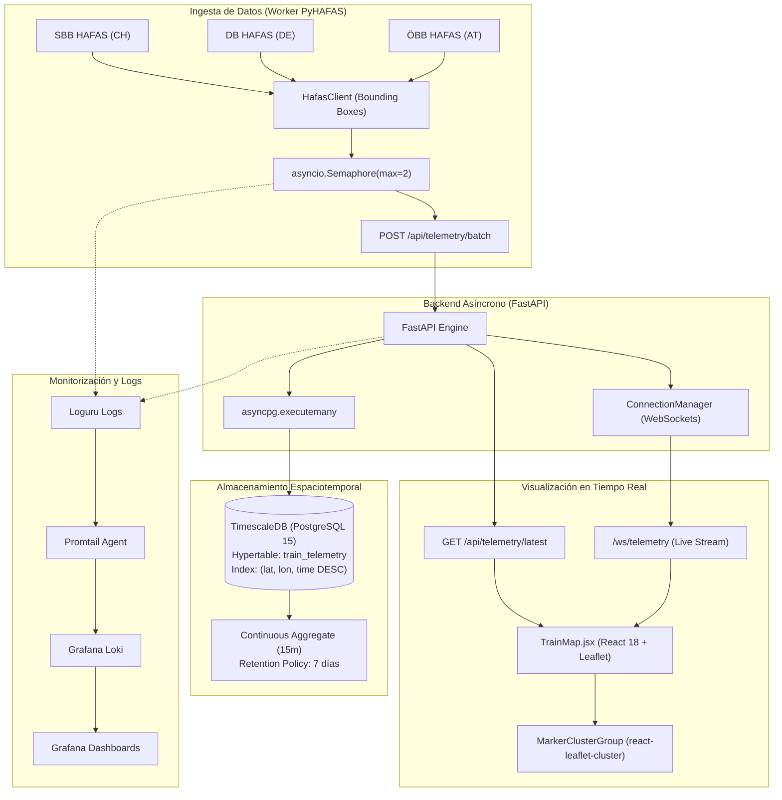

# 🚄 RailScope Global — Real-Time Rail Telemetry Platform (Europe, Asia & North America)

<div align="center">

[](https://cast0rtech.github.io/Railscope/)
[](https://opensource.org/licenses/MIT)
[](https://www.python.org/)
[](https://fastapi.tiangolo.com/)
[](https://react.dev/)
[](https://www.timescale.com/)
[](https://www.docker.com/)

**Rastreo en tiempo real, indexación espacio-temporal y visualización en vivo del tráfico ferroviario y de alta velocidad en Europa, Asia y Norteamérica (EE.UU., Canadá y México).**

[🌐 Ver Aplicación en Vivo (Live Demo)](https://cast0rtech.github.io/Railscope/) • [📖 Arquitectura](#arquitectura-del-sistema) • [🚀 Despliegue Rápido](#guía-de-despliegue-rápido) • [📡 Endpoints API](#referencia-de-la-api--websockets)

</div>

---

## 📌 Descripción del Proyecto

**RailScope Global** es una plataforma telemática distribuida de alto rendimiento diseñada para la ingesta, indexación espacio-temporal y visualización en tiempo real del tráfico ferroviario y corredores de alta velocidad en **Europa**, **Asia** y **Norteamérica**.

Monitorea simultáneamente los corredores de alta velocidad de operadores nacionales y compañías privadas en España, Francia, Italia, Alemania, Suiza, Austria, Reino Unido, Países Bajos, Bélgica, Suecia, Polonia, Portugal, Estados Unidos (Amtrak Acela, Brightline, Caltrain), Canadá (VIA Rail, Rocky Mountaineer), México (Tren Maya, El Insurgente), Japón (Shinkansen), China (CR / Fuxing), Corea del Sur (KTX / SRT), Taiwán (THSR), India (Vande Bharat), Uzbekistán (Afrosiyob), Turquía (YHT), Arabia Saudí (Haramain) e Indonesia (Whoosh).

---

## ⚡ Características Principales

* **Cobertura Ferroviaria Multicontinental (Europa, Asia & Norteamérica):** Rastreo en vivo de flotas estatales y operadoras privadas liberalizadas con filtrado por continente y país.
* **Motor On-Device 100% Autosuficiente:** Funciona de forma autónoma en navegadores web y en dispositivos Android sin depender de servidores locales.
* **Ingesta Concurrente con Semáforo:** Worker asíncrono con clientes HAFAS y barrido geográfico por cuadrículas (*Bounding Boxes*) limitado a 2 conexiones simultáneas para prevenir bloqueos de IP.
* **Persistencia Espacio-Temporal en TimescaleDB:** 
  * Tabla `train_telemetry` convertida en **Hypertable** particionada por tiempo con índices compuestos geoespaciales (`lat`, `lon`, `time DESC`).
  * Downsampling continuo cada 15 minutos (*Continuous Aggregate*) y política de retención estricta de 7 días.
* **Retransmisión Ultrarrápida por WebSockets:** Servidor FastAPI con `ConnectionManager` nativo y difusión masiva paralela tras cada lote de coordenadas.
* **Mapa Interactivo de Alto Rendimiento:** Frontend React + Vite con Leaflet y agrupación dinámica de marcadores (`react-leaflet-cluster`) con controles de navegación continentales y encuadre fluido (*flyTo*).
* **Compilación Móvil Nativa (Android APK):** Soporte móvil con Capacitor 6 y configuración optimizada para red local (`usesCleartextTraffic`).
* **Seguridad de Nivel Producción:**
  * Contenedores Docker optimizados para ejecución con usuarios no privilegiados (*non-root*).
  * Política de Seguridad de Contenido (*Content Security Policy - CSP*) estricta.
  * Proxy inverso Nginx con persistencia de cabeceras WebSocket (`Upgrade` / `Connection`).
  * Hardening con **Fail2ban** (`jail.local`) con baneo de fuerza bruta SSH y escáneres anti-bots.
* **Observabilidad Completa:** Stack integrado de Grafana, Loki y Promtail para centralización de logs y métricas.

---

## 🚅 Operadores Ferroviarios Soportados

### 🌎 Norteamérica (EE.UU., Canadá & México)
| País / Región | Operador | Tipo | Modelo de Tren / Material Rodante | Velocidad Máx. | Corredores Clave |
| :--- | :--- | :---: | :--- | :---: | :--- |
| **Estados Unidos** 🇺🇸 | **Amtrak Acela** | **Estatal** | Alstom Avelia Liberty / Acela II | 240 km/h (150 mph) | Corredor Noreste (NEC): Boston - Nueva York - Filadelfia - Washington D.C. |
| **Estados Unidos** 🇺🇸 | **Amtrak Intercity** | **Estatal** | Siemens ALC-42 Charger / Venture | 200 km/h (125 mph) | Northeast Regional, Empire Service, Pacific Surfliner, Cascades |
| **Estados Unidos** 🇺🇸 | **Brightline Florida** | **Privado** | Siemens SCB-40 Charger | 200 km/h (125 mph) | Aeropuerto de Orlando - West Palm Beach - Fort Lauderdale - MiamiCentral |
| **Estados Unidos** 🇺🇸 | **Caltrain Electric** | **Público** | Stadler KISS EMU | 180 km/h (110 mph) | San Francisco 4th & King - Millbrae - Palo Alto - San José Diridon |
| **Canadá** 🇨🇦 | **VIA Rail Canada** | **Estatal** | Siemens Charger Venture Trainsets | 160 km/h (100 mph) | Corredor Québec City - Montreal - Ottawa - Kingston - Toronto Union |
| **Canadá** 🇨🇦 | **Rocky Mountaineer** | **Privado** | GoldLeaf Dome Bi-Level | 110 km/h | Vancouver - Kamloops - Banff / Jasper (Montañas Rocosas) |
| **México** 🇲🇽 | **Tren Maya** | **Estatal** | Alstom Xiinbal D-EMU | 160 km/h | Cancún Aeropuerto - Playa del Carmen - Tulum - Mérida - Palenque |
| **México** 🇲🇽 | **Tren El Insurgente** | **Estatal** | CAF Civity 160 EMU | 160 km/h | Zinacantepec (Toluca) - Lerma - Santa Fe (Ciudad de México) |

### 🇪🇺 Europa
| País / Región | Operador | Tipo | Modelo de Tren / Material Rodante | Velocidad Máx. | Corredores Clave |
| :--- | :--- | :---: | :--- | :---: | :--- |
| **España** 🇪🇸 | **iryo** (ILSA) | **Privado** | Frecciarossa 1000 (ETR 1000) | 300 km/h | Madrid - Zaragoza - Barcelona, Madrid - Valencia, Madrid - Sevilla/Málaga |
| **España** 🇪🇸 | **Ouigo España** | **Privado** | Alstom Euroduplex (2 pisos) | 300 km/h | Madrid Chamartín - Barcelona, Madrid - Valencia, Valladolid/Segovia |
| **España** 🇪🇸 | **Renfe AVE / Avlo** | **Estatal** | Talgo S-106 Avril / S-103 | 310 km/h | Eje Troncal Madrid - Cataluña, Andalucía, Levante, Galicia y Norte |
| **Italia** 🇮🇹 | **Italo** (NTV) | **Privado** | Alstom AGV 575 / Italo EVO | 300 km/h | Turín - Milán - Bolonia - Florencia - Roma - Nápoles - Salerno; Venecia |
| **Italia** 🇮🇹 | **Trenitalia FS** | **Estatal** | Frecciarossa 1000 / ETR 500 | 300 km/h | Eje Norte-Sur Milán - Roma - Nápoles, Corredor Véneto, Calabria |
| **Alemania** 🇩🇪 | **FlixTrain** | **Privado** | Vectron Express | 200 km/h | Berlín - Frankfurt - Stuttgart, Hamburgo - Colonia, Múnich |
| **Alemania** 🇩🇪 | **Deutsche Bahn (DB)** | **Estatal** | ICE 3 / ICE 4 / ICE Neo | 300 km/h | Múnich - Núremberg - Berlín, Frankfurt - Colonia, Hamburgo |
| **Francia** 🇫🇷 | **Eurostar** | **Privado/Int.** | Siemens Velaro e320 / PBKA | 300 km/h | París - Bruselas - Colonia - Düsseldorf - Ámsterdam; Londres |
| **Francia** 🇫🇷 | **SNCF TGV inOui** | **Estatal** | TGV Duplex / TGV M | 320 km/h | París - Lyon - Marsella/Niza, París - Burdeos, París - Lille |
| **Austria / Alemania** 🇦🇹🇩🇪 | **Westbahn** | **Privado** | Stadler KISS 200 | 200 km/h | Viena Westbahnhof - Salzburgo - Múnich Hbf |
| **Austria** 🇦🇹 | **ÖBB Railjet** | **Estatal** | Siemens Viaggio / Nightjet | 230 km/h | Viena - Linz - Salzburgo - Innsbruck, Graz |
| **Suiza** 🇨🇭 | **SBB CFF FFS** | **Estatal** | Stadler Giruno / Twindexx | 250 km/h | Zúrich - Basilea - Ginebra, Túnel de Base de San Gotardo |
| **Reino Unido** 🇬🇧 | **LNER / Avanti** | **Franquicia** | Hitachi Azuma / Class 390 Pendolino | 200 km/h | Londres King's Cross - Edimburgo; Londres Euston - Mánchester |
| **Países Bajos** 🇳🇱 | **NS** | **Estatal** | ICNG (Alstom Coradia Stream) | 200 km/h | Ámsterdam Centraal - Róterdam - Breda |
| **Bélgica** 🇧🇪 | **SNCB / NMBS** | **Estatal** | Siemens HLE 18 / M7 | 200 km/h | Bruselas-Midi - Amberes - Lieja |
| **Suecia** 🇸🇪 | **SJ** | **Estatal** | X2000 / SJ 3000 | 205 km/h | Estocolmo Central - Gotemburgo - Malmö |
| **Polonia** 🇵🇱 | **PKP Intercity** | **Estatal** | ED250 Pendolino | 200 km/h | Varsovia Central - Cracovia - Gdansk |
| **Portugal** 🇵🇹 | **CP** | **Estatal** | Alfa Pendular (CPA 4000) | 220 km/h | Lisboa Santa Apolónia - Oporto Campanhã |

### 🌏 Asia
| País / Región | Operador | Tipo | Modelo de Tren / Material Rodante | Velocidad Máx. | Corredores Clave |
| :--- | :--- | :---: | :--- | :---: | :--- |
| **Japón** 🇯🇵 | **JR Shinkansen** | **Concesión** | Shinkansen N700S / E5 Hayabusa | 320 km/h | Tokaido/Sanyo (Tokio - Shin-Osaka - Hakata); Tohoku (Tokio - Shin-Aomori) |
| **China** 🇨🇳 | **China Railway (CR)** | **Estatal** | CR400AF/BF Fuxing Hao / CRH380 | 350 km/h | Pekín - Shanghái (HSR); Pekín - Cantón; Cantón - Shenzhen - Hong Kong |
| **Corea del Sur** 🇰🇷 | **Korail KTX / SRT** | **Estatal/Priv.** | KTX-Sancheon / SR Class 130000 | 305 km/h | Seúl / Suseo - Daejeon - Daegu - Busan (Gyeongbu) y Honam |
| **Taiwán** 🇹🇼 | **THSR** | **Privado** | THSR 700T Series | 300 km/h | Taipéi Main Station - Taichung - Kaohsiung Zuoying |
| **India** 🇮🇳 | **Indian Railways** | **Estatal** | Vande Bharat Express (Train 18) | 160 km/h | Nueva Delhi - Varanasi; Mumbai Central - Gandhinagar Capital |
| **Uzbekistán** 🇺🇿 | **Afrosiyob (UTY)** | **Estatal** | Talgo 250 Afrosiyob | 250 km/h | Taskent - Samarcanda - Bujará |
| **Turquía** 🇹🇷 | **TCDD Taşımacılık** | **Estatal** | YHT HT65000 / Siemens Velaro TR | 300 km/h | Ankara - Estambul Söğütlüçeşme; Ankara - Konya |
| **Arabia Saudí** 🇸🇦 | **Haramain (SAR)** | **Estatal** | Talgo 350 SRO | 300 km/h | La Meca - Yeda (Aeropuerto) - Medina |
| **Indonesia** 🇮🇩 | **Whoosh (KCIC)** | **Consorcio** | KCIC400AF Red Panda | 350 km/h | Yakarta Halim - Karawang - Bandung Tegalluar (350 km/h) |

---

## 🏛️ Arquitectura del Sistema



---

## 🚀 Guía de Despliegue Rápido

### 1. Clonar el Repositorio y Configurar Secretos

```bash
git clone https://github.com/cast0rtech/Railscope.git
cd Railscope
cp .env.example .env
```

Edita `.env` para personalizar credenciales seguras:
```bash
POSTGRES_USER=rail_admin
POSTGRES_PASSWORD=tu_contraseña_segura
POSTGRES_DB=railscope
FRONTEND_URL=https://cast0rtech.github.io
```

### 2. Arrancar el Stack Completo con Docker

El proyecto incluye un [Makefile](file:///Users/castordfedez/Desktop/Railscope/Makefile) con atajos DevOps para automatizar la ejecución:

```bash
# Compilar imágenes y arrancar los 6 servicios en segundo plano
make start

# Ver el streaming de logs unificado
make logs

# Consultar el estado y salud de los contenedores
make status

# Detener todos los servicios
make stop
```

---

## 📡 Referencia de la API & WebSockets

| Método | Endpoint | Descripción | Formato / Protocolo |
| :---: | :--- | :--- | :---: |
| `GET` | `/healthz` | Health check de la API y verificación de conexión a TimescaleDB. | JSON |
| `POST` | `/api/telemetry/batch` | Ingesta masiva de coordenadas satelitales en lote (`asyncpg.executemany`). | JSON Array |
| `GET` | `/api/telemetry/latest` | Consulta optimizada con `DISTINCT ON (train_id)` para obtener el último estado de cada convoy. | JSON Array |
| `WS` | `/ws/telemetry` | Canal bidireccional para retransmisión de coordenadas en tiempo real a clientes frontend. | WebSocket |

---

## 🛡️ Seguridad e Infraestructura en Producción

* **Reverse Proxy Nginx:** Configuración lista para desplegar en `/etc/nginx/sites-available/railscope.conf` con soporte WebSocket y buffers optimizados en [infra/railscope_nginx.conf](file:///Users/castordfedez/Desktop/Railscope/infra/railscope_nginx.conf).
* **Hardening Anti-Intrusión:** Configuración de Fail2ban con reglas para SSH, HTTP Auth y escáneres de vulnerabilidades (`nginx-botsearch`) en [deploy/security/jail.local](file:///Users/castordfedez/Desktop/Railscope/deploy/security/jail.local).
* **Contenedores Aislados:** Todas las imágenes Docker (`backend` y `worker`) se ejecutan con usuarios sin privilegios (`UID 10001` y `UID 10002`).
* **Puertos de Host Protegidos:** Todos los servicios en `docker-compose.yml` están expuestos estrictamente en `127.0.0.1`.

---

## 📄 Licencia

Este proyecto se distribuye bajo la licencia **MIT**. Consulta el archivo `LICENSE` para más información.

<div align="center">
Desarrollado con ❤️ para la comunidad de Open Data y entusiastas de la infraestructura ferroviaria europea.
</div>
