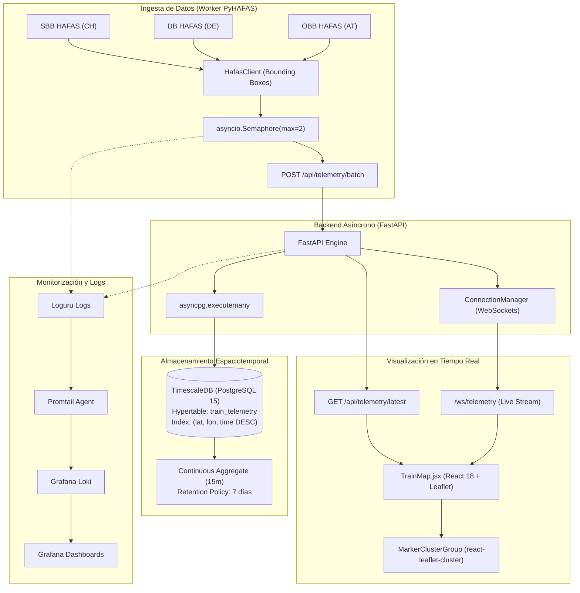

# 🚄 RailScope EU — Real-Time European Rail Telemetry Platform

<div align="center">

[](https://cast0rtech.github.io/Railscope/)
[](https://opensource.org/licenses/MIT)
[](https://www.python.org/)
[](https://fastapi.tiangolo.com/)
[](https://react.dev/)
[](https://www.timescale.com/)
[](https://www.docker.com/)

**Real-time tracking, spatiotemporal indexing, and live visualization of high-speed passenger rail traffic across Europe.**

[🌐 Ver Aplicación en Vivo (Live Demo)](https://cast0rtech.github.io/Railscope/) • [📖 Arquitectura](#arquitectura-del-sistema) • [🚀 Despliegue Rápido](#guía-de-despliegue-rápido) • [📡 Endpoints API](#referencia-de-la-api--websockets)

</div>

---

## 📌 Descripción del Proyecto

**RailScope EU** es una plataforma telemática distribuida de alto rendimiento diseñada para la ingesta, indexación espacio-temporal y visualización en tiempo real del tráfico ferroviario europeo. 

Monitorea simultáneamente los corredores de alta velocidad de los operadores nacionales estatales y de las nuevas compañías privadas surgidas tras la liberalización ferroviaria en España, Francia, Italia, Alemania, Suiza y Austria.

---

## ⚡ Características Principales

* **Cobertura Ferroviaria Multiórgano:** Rastreo en vivo de flotas estatales y operadoras privadas liberalizadas.
* **Ingesta Concurrente con Semáforo:** Worker asíncrono con clientes HAFAS y barrido geográfico por cuadrículas (*Bounding Boxes*) limitado a 2 conexiones simultáneas para prevenir bloqueos de IP.
* **Persistencia Espacio-Temporal en TimescaleDB:** 
  * Tabla `train_telemetry` convertida en **Hypertable** particionada por tiempo.
  * Índices compuestos optimizados para búsquedas geoespaciales por cuadrante (`lat`, `lon`, `time DESC`).
  * Downsampling continuo cada 15 minutos (*Continuous Aggregate*) y política de retención estricta de 7 días.
* **Retransmisión Ultrarrápida por WebSockets:** Servidor FastAPI con `ConnectionManager` nativo y difusión masiva paralela tras cada lote de coordenadas.
* **Mapa Interactivo de Alto Rendimiento:** Frontend React + Vite con Leaflet y agrupación dinámica de marcadores (`react-leaflet-cluster`) que disuelve o agrupa miles de convoyes según el nivel de zoom.
* **Seguridad de Nivel Producción:**
  * Contenedores Docker optimizados para ejecución con usuarios no privilegiados (*non-root*).
  * Política de Seguridad de Contenido (*Content Security Policy - CSP*) estricta.
  * Proxy inverso Nginx con persistencia de cabeceras WebSocket (`Upgrade` / `Connection`).
  * Hardening con **Fail2ban** (`jail.local`) con baneo de fuerza bruta SSH y escáneres anti-bots.
* **Observabilidad Completa:** Stack integrado de Grafana, Loki y Promtail para centralización de logs y métricas.

---

## 🚅 Operadores Ferroviarios Soportados

| País / Región | Operador | Tipo | Modelo de Tren / Material Rodante | Velocidad Máx. | Corredores Clave |
| :--- | :--- | :---: | :--- | :---: | :--- |
| **España** 🇪🇸 | **iryo** (ILSA) | **Privado** | Frecciarossa 1000 (ETR 1000) | 300 km/h | Madrid - Zaragoza - Barcelona, Madrid - Valencia, Madrid - Sevilla/Málaga |
| **España** 🇪🇸 | **Ouigo España** | **Privado** | Alstom Euroduplex (2 pisos) | 300 km/h | Madrid Chamartín - Barcelona, Madrid - Valencia, Valladolid/Segovia |
| **España** 🇪🇸 | **Renfe AVE / Avlo** | **Estatal** | Talgo S-106 Avril / S-103 | 310 km/h | Eje Troncal Madrid - Cataluña, Andalucía, Levante y Norte |
| **Italia** 🇮🇹 | **Italo** (NTV) | **Privado** | Alstom AGV 575 / Italo EVO | 300 km/h | Turín - Milán - Bolonia - Florencia - Roma - Nápoles - Salerno; Venecia |
| **Italia** 🇮🇹 | **Trenitalia FS** | **Estatal** | Frecciarossa 1000 / ETR 500 | 300 km/h | Eje Norte-Sur Milán - Roma - Nápoles, Corredor Véneto |
| **Alemania** 🇩🇪 | **FlixTrain** | **Privado** | Vectron Express | 200 km/h | Berlín - Frankfurt - Stuttgart, Hamburgo - Colonia, Múnich |
| **Alemania** 🇩🇪 | **Deutsche Bahn (DB)** | **Estatal** | ICE 3 / ICE 4 / ICE Neo | 300 km/h | Múnich - Núremberg - Berlín, Frankfurt - Colonia, Hamburgo |
| **Francia** 🇫🇷 | **Eurostar** | **Privado/Int.** | Siemens Velaro e320 / PBKA | 300 km/h | París - Bruselas - Colonia - Düsseldorf - Ámsterdam |
| **Francia** 🇫🇷 | **SNCF TGV inOui** | **Estatal** | TGV Duplex / TGV M | 320 km/h | París - Lyon - Marsella/Niza, París - Burdeos |
| **Austria / Alemania** 🇦🇹🇩🇪 | **Westbahn** | **Privado** | Stadler KISS 200 | 200 km/h | Viena Westbahnhof - Salzburgo - Múnich Hbf |
| **Austria** 🇦🇹 | **ÖBB Railjet** | **Estatal** | Siemens Viaggio / Nightjet | 230 km/h | Viena - Linz - Salzburgo - Innsbruck, Graz |
| **Suiza** 🇨🇭 | **SBB CFF FFS** | **Estatal** | Stadler Giruno / Twindexx | 250 km/h | Zúrich - Basilea - Ginebra, Túnel de Base de San Gotardo hacia Italia |

---

## 🏛️ Arquitectura del Sistema



---

## 🚀 Guía de Despliegue Rápido

### 1. Clonar el Repositorio y Configurar Secretos

```bash
git clone https://github.com/cast0rtech/Railscope.git
cd Railscope
cp .env.example .env
```

Edita `.env` para personalizar credenciales seguras:
```bash
POSTGRES_USER=rail_admin
POSTGRES_PASSWORD=tu_contraseña_segura
POSTGRES_DB=railscope
FRONTEND_URL=https://cast0rtech.github.io
```

### 2. Arrancar el Stack Completo con Docker

El proyecto incluye un [Makefile](file:///Users/castordfedez/Desktop/Railscope/Makefile) con atajos DevOps para automatizar la ejecución:

```bash
# Compilar imágenes y arrancar los 6 servicios en segundo plano
make start

# Ver el streaming de logs unificado
make logs

# Consultar el estado y salud de los contenedores
make status

# Detener todos los servicios
make stop
```

---

## 📡 Referencia de la API & WebSockets

| Método | Endpoint | Descripción | Formato / Protocolo |
| :---: | :--- | :--- | :---: |
| `GET` | `/healthz` | Health check de la API y verificación de conexión a TimescaleDB. | JSON |
| `POST` | `/api/telemetry/batch` | Ingesta masiva de coordenadas satelitales en lote (`asyncpg.executemany`). | JSON Array |
| `GET` | `/api/telemetry/latest` | Consulta optimizada con `DISTINCT ON (train_id)` para obtener el último estado de cada convoy. | JSON Array |
| `WS` | `/ws/telemetry` | Canal bidireccional para retransmisión de coordenadas en tiempo real a clientes frontend. | WebSocket |

---

## 🛡️ Seguridad e Infraestructura en Producción

* **Reverse Proxy Nginx:** Configuración lista para desplegar en `/etc/nginx/sites-available/railscope.conf` con soporte WebSocket y buffers optimizados en [infra/railscope_nginx.conf](file:///Users/castordfedez/Desktop/Railscope/infra/railscope_nginx.conf).
* **Hardening Anti-Intrusión:** Configuración de Fail2ban con reglas para SSH, HTTP Auth y escáneres de vulnerabilidades (`nginx-botsearch`) en [deploy/security/jail.local](file:///Users/castordfedez/Desktop/Railscope/deploy/security/jail.local).
* **Contenedores Aislados:** Todas las imágenes Docker (`backend` y `worker`) se ejecutan con usuarios sin privilegios (`UID 10001` y `UID 10002`).
* **Puertos de Host Protegidos:** Todos los servicios en `docker-compose.yml` están expuestos estrictamente en `127.0.0.1`.

---

## 📄 Licencia

Este proyecto se distribuye bajo la licencia **MIT**. Consulta el archivo `LICENSE` para más información.

<div align="center">
Desarrollado con ❤️ para la comunidad de Open Data y entusiastas de la infraestructura ferroviaria europea.
</div>
